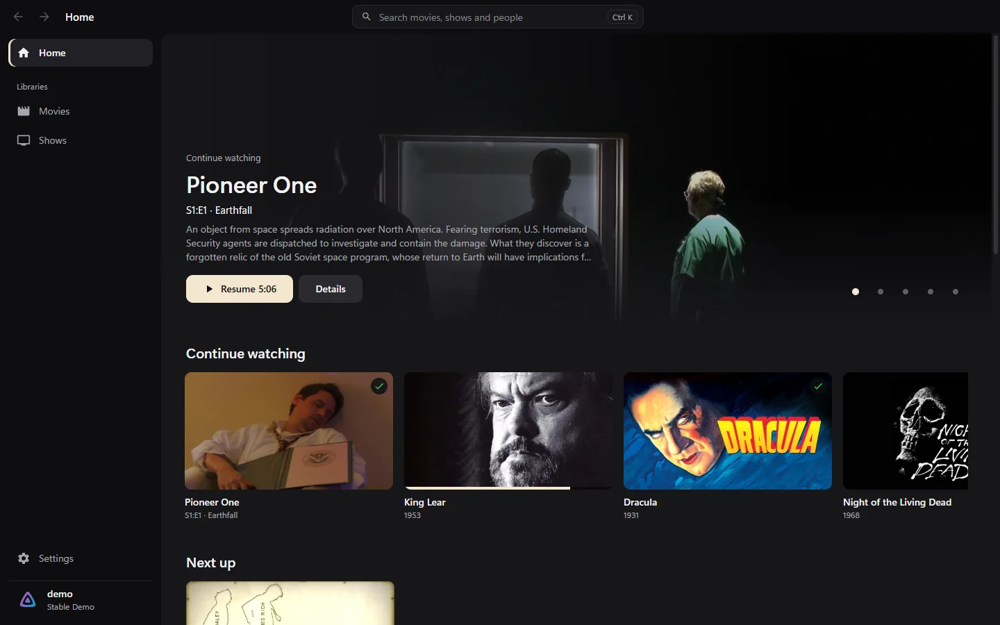
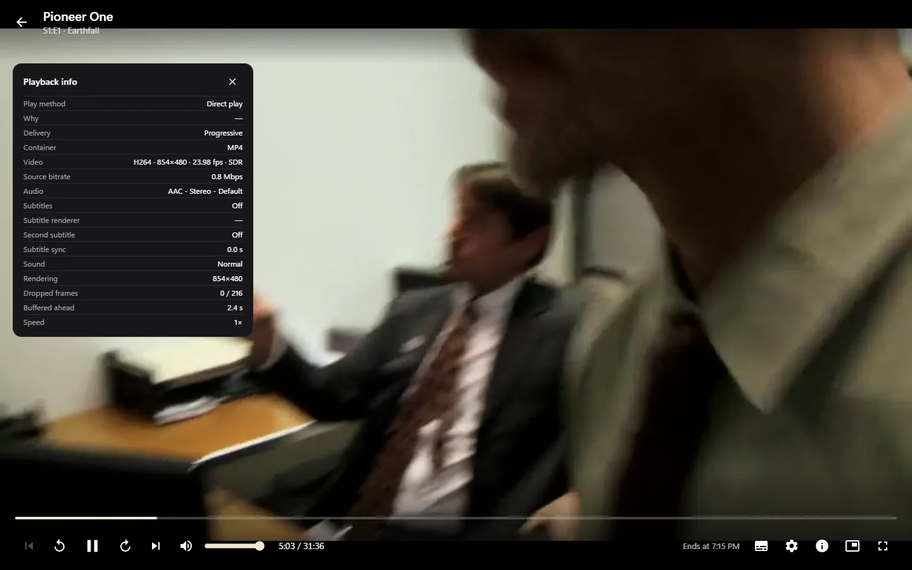
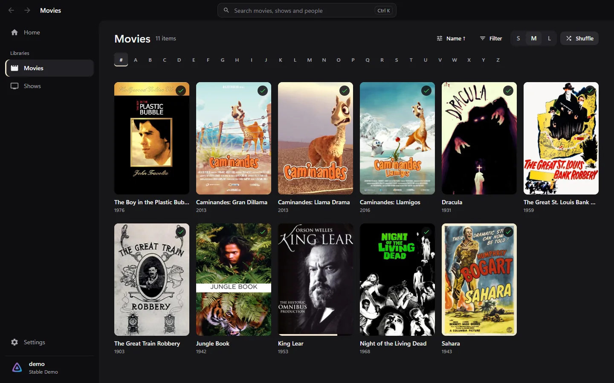
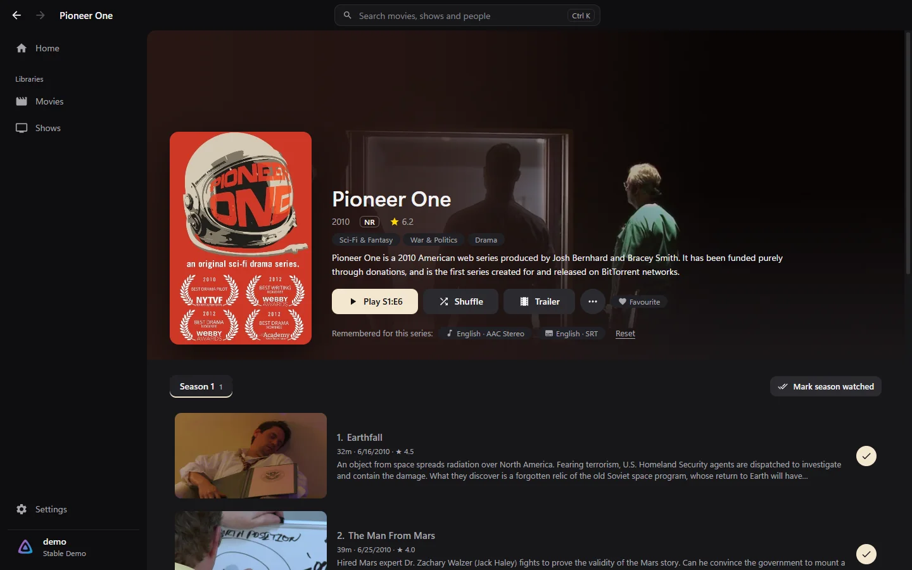
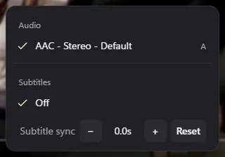
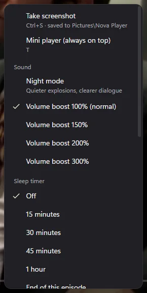
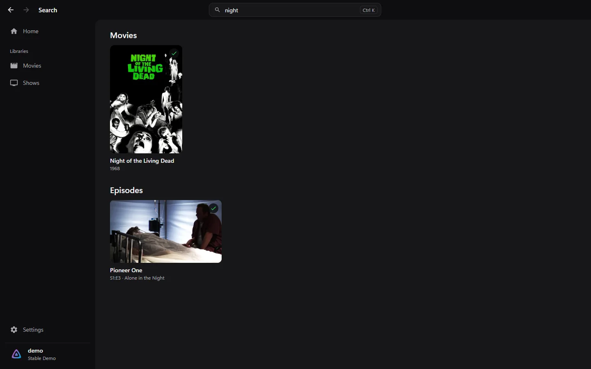
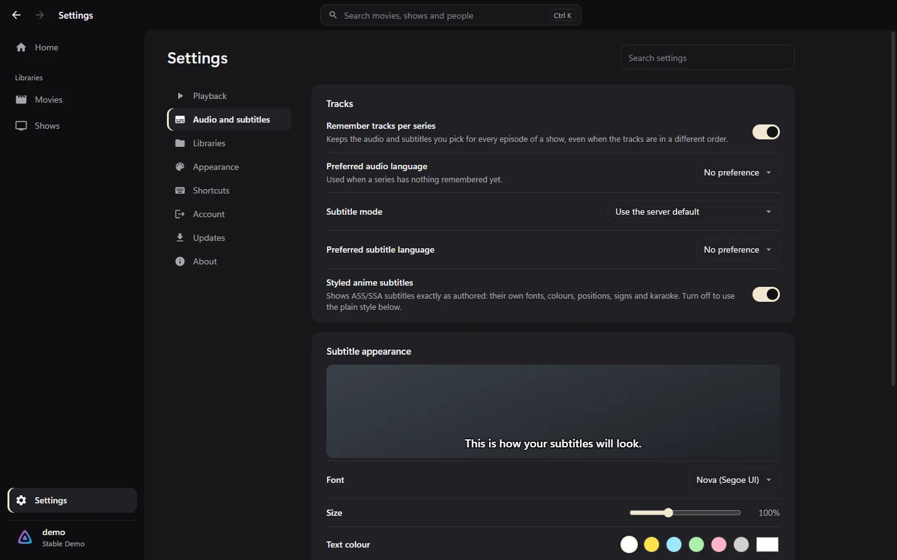
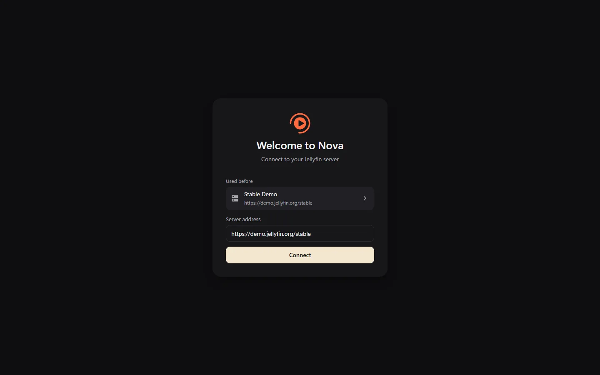

<div align="center">


# Nova Player

**The Jellyfin player for Windows that just works.**

Nova opens the moment you press Play, never freezes, remembers how you sort every library,
and keeps your audio and subtitle choices for the whole series.

[](https://github.com/Bryson-he/nova-player/releases/latest)
[](https://github.com/Bryson-he/nova-player/releases)


[](LICENSE)

### [Download for Windows](https://github.com/Bryson-he/nova-player/releases/latest/download/NovaPlayer-Setup.exe)

<sub>[Portable version](https://github.com/Bryson-he/nova-player/releases/latest/download/NovaPlayer-Portable.exe) · [Website](https://bryson-he.github.io/nova-player/) · [All releases](https://github.com/Bryson-he/nova-player/releases)</sub>



</div>

## What's new in 2.0

- **A new look.** Calm graphite, one warm accent and the posters doing the colour. Mica on Windows 11, a new
  icon, and a title bar with Back, Forward and search.
- **Search from anywhere.** Press `Ctrl K` and results appear as you type, including people. Recent searches are kept.
- **Native on Windows.** Play, pause and skip from the taskbar thumbnail, see progress on the taskbar icon, and
  jump straight back into a show from the taskbar's Continue watching list.
- **Find your server.** Nova lists Jellyfin servers on your network and ones you've used before. Switch user or
  server from the account menu.
- **Easier to use with a keyboard or screen reader.** Every screen works with the keyboard alone, menus and season
  tabs follow the arrow keys, and `?` shows every shortcut.
- **Yours to adjust.** Use your Windows accent colour, tint pages with the artwork, reduce motion or transparency,
  and zoom the whole app with `Ctrl +` and `Ctrl −`.
- **Safer by design.** Your sign-in stays inside Nova's core and is never written into links, the connection prefers
  HTTPS, and every release is built and published by a reviewed, pinned GitHub workflow.

## Features

### Never freezes on Play

The official Jellyfin desktop app can lock up the moment you start something. Nova can't:

- The player opens **instantly**. Everything after that happens in the background, with a **Cancel** button the
  whole time.
- Every request to your server has a timeout, and **Back** or **Esc** cancels it on the spot.
- If a file can't play directly on your PC, Nova **switches to server transcoding by itself** instead of hanging.
- If something goes wrong, the player says what happened in plain words, with **Retry**, **Retry with
  transcoding** and **Copy details**.
- Press **`I`** for the playback info panel. It tells you *why* something is transcoding.

<div align="center">

</div>

### Sorting that sticks

Every library remembers its own **sort, order, filter, genre and card size**, even after a restart. Sort your anime
by *Latest episode added* once and it stays that way.

- Active filters show as chips next to the title; click one to remove it.
- Going back from a show restores your **exact scroll position**, and **Forward** works too.
- **A–Z jump bar** when sorting by name, for big libraries.
- **Shuffle** a whole library, or a single show.

<div align="center">

</div>

### Remembers your audio and subtitles for the whole series

Pick Japanese audio and English subtitles in any episode, and **every episode of that show follows**. Nova
remembers *what* the track is, not its position: the language, its title (*Signs & Songs*, *Full Subtitles*…),
whether it's forced or SDH, commentary or main audio, and the codec.

So it picks the right tracks even when episodes order them differently, which is exactly where Jellyfin's own
"remember my selection" breaks. Subtitle sync is remembered per series too.

<div align="center">

</div>

### Anime subtitles done right

- **Styled ASS/SSA subtitles** are drawn by libass exactly as the release authored them: their own fonts
  (including ones embedded in the file), colours, signs, positioning and karaoke. They're ready the moment an
  episode starts, and the next episode's subtitles load while you watch.
- **Dual subtitles**: a second language at the top of the picture. Great for learning a language.
- **Live sync** with `Z` / `X`, remembered for the series.
- Image subtitles (PGS / VobSub) are burned in by the server automatically.
- Plain subtitles get your own **font, size, colour, edge, background and position**.

<div align="center">

</div>

<table>
<tr>
<td width="50%" align="center" valign="top">
<br>
<sub>Audio and subtitles in one menu</sub>
</td>
<td width="50%" align="center" valign="top">
<br>
<sub>Night mode, volume boost, sleep timer, speed and quality</sub>
</td>
</tr>
</table>

### Built for binge-watching

- **New badges** on shows with recently added episodes, on the new episodes themselves, and a **New episodes**
  row on Home. You choose how long things count as new.
- **Skip intro and recap** with a button, or automatically. Uses Jellyfin media segments (10.10+) or the Intro
  Skipper plugin.
- **Up Next** when the credits start; the countdown waits while you point at it.
- **Still watching?** after a few episodes play on their own, so a series doesn't run all night. And a **sleep
  timer** that pauses after a while or stops at the end of the episode.
- **Chapters** on the seek bar, **trickplay previews** when you hover it, and `PgUp` / `PgDn` to jump.
- **Night mode** evens out explosions and dialogue, and **volume boost** goes up to 300% for quiet files.
- **Video fit**: fit, fill, stretch or zoom with `V`, for ultrawide screens and letterboxed files.

### Mini player

Press **`T`** and Nova shrinks into a small always-on-top window in the corner of your screen, subtitles and all.

<div align="center">

</div>

### And the rest

- **Updates itself** in the background and installs when you close Nova. Turn on **Get beta versions** to try
  new releases early.
- **Right-click anything** (or press the Menu key) for play, from start, mark watched, favourite, shuffle and go to
  series.
- **Screenshots** with `Ctrl S`, saved to `Pictures\Nova Player`.
- **Copy debug info** in Settings → About, with your server address and sign-in removed, for bug reports.
- **Quick Connect** sign-in, media keys, and your screen stays awake while something plays.

<details>
<summary><b>More screenshots</b></summary>
<br>

| | |
|---|---|
|  |  |
| **Search** as you type, from anywhere | **Settings** in two panes, with search |
|  |  |
| **Sign in** to a server found or used before | **Player** with playback info |

</details>

## Install

1. Download **[`NovaPlayer-Setup.exe`](https://github.com/Bryson-he/nova-player/releases/latest/download/NovaPlayer-Setup.exe)**
   from the latest release.
2. Run it. By default it installs just for you, so it doesn't need admin rights.
3. Windows may show **"Windows protected your PC"** because the installer isn't code-signed yet. Click
   **More info → Run anyway**. Each release lists SHA-256 hashes and a build provenance record you can check.

Prefer not to install anything? The **[portable version](https://github.com/Bryson-he/nova-player/releases/latest/download/NovaPlayer-Portable.exe)**
runs from anywhere. It can't update itself, but it tells you when there's a new version.

Works with **Jellyfin 10.8 and newer** on **Windows 10 and 11** (64-bit). Mica needs Windows 11.

## Getting started

1. **Connect.** Pick a server Nova found on your network, or type its address, like `192.168.1.20` or
   `https://jellyfin.example.com`. Nova tries HTTPS first, and port 8096 on your home network.
2. **Sign in** with your username and password, or use **Quick Connect** from a device that's already signed in.
3. **Set your sort.** Open a library and pick how you like it sorted. Nova remembers it from now on.
4. **Pick your tracks once.** Start an episode, choose audio and subtitles, and the rest of the series follows.

> [!TIP]
> Want **Skip intro**? On Jellyfin 10.10 or newer, turn on media segment detection in your server's dashboard, or
> install the **Intro Skipper** plugin. Nova picks the segments up automatically.

## Keyboard shortcuts

Press **`?`** anywhere in Nova to see them all.

| Key | Action | Key | Action |
|---|---|---|---|
| `Ctrl K` | Search | `Alt ←` / `Alt →` | Back / forward |
| `Space` / `K` | Play / pause | `F` | Fullscreen |
| `←` / `→` | Seek (hold `Shift` for 60 s) | `M` | Mute |
| `J` / `L` | −10 s / +10 s | `A` / `S` | Next audio / subtitle track |
| `↑` / `↓` | Volume | `Z` / `X` | Subtitle sync −/+ 0.1 s |
| `0`–`9` | Jump to 0–90% | `[` / `]` | Slower / faster |
| `N` / `P` | Next / previous episode | `I` | Playback info |
| `PgUp` / `PgDn` | Previous / next chapter | `T` | Mini player |
| `V` | Video fit | `Ctrl S` | Screenshot |
| `Ctrl +` / `Ctrl −` / `Ctrl 0` | Zoom | `Esc` | Leave fullscreen or close the player |

## FAQ

<details>
<summary><b>A video won't play, or it's transcoding when I don't expect it to.</b></summary>

Press **`I`** while it's playing. The **Why** line says what your PC can't handle, like 10-bit H.264 or DTS audio.
Nova then asks the server to convert just that part. If playback fails completely, choose **Retry with transcoding**.
</details>

<details>
<summary><b>Nova warned me the connection isn't encrypted.</b></summary>

Your server address starts with `http://` and isn't on your home network, so your password would travel in plain
text. Use the server's `https://` address if it has one. Servers on your home network or Tailscale don't trigger
the warning.
</details>

<details>
<summary><b>The Skip intro button never shows up.</b></summary>

Nova uses the intro and credit markers your server provides. On Jellyfin 10.10+, enable media segments in the
dashboard and let the scheduled task scan your library, or install the **Intro Skipper** plugin.
</details>

<details>
<summary><b>Styled subtitles look wrong, or use the wrong font.</b></summary>

Fonts come from the video file itself when it includes them. If a font is missing, libass falls back to a similar
one. You can switch to plain subtitles under **Settings → Audio and subtitles → Styled anime subtitles**.
</details>

<details>
<summary><b>Windows blocked the installer.</b></summary>

Nova isn't code-signed yet, so SmartScreen may warn you: click **More info → Run anyway**. If **Smart App Control**
is turned on, Windows may block unsigned apps entirely; there's no safe way around that until Nova is signed.
</details>

<details>
<summary><b>What does Nova send, and where?</b></summary>

Only what any Jellyfin app does, to your own server: what you watch, so your progress stays in sync across devices.
The only other connection is to GitHub, to check for updates. No analytics, usage data or crash reports. Your
settings, sorting and track memory stay on your PC in `%APPDATA%\Nova Player`.
</details>

## How it plays your videos

When you press Play, Nova tells your server exactly which formats this PC can decode (H.264, HEVC, AV1, VP9, AAC,
Opus, FLAC… checked live on your hardware). If the file fits, it **direct plays** with no conversion at all. If only
the container doesn't fit, the server **remuxes** it without touching quality. Only what's truly unsupported gets
**transcoded**, streamed over HLS.

Styled subtitles are rendered by **libass** compiled to WebAssembly (JASSUB), on a separate thread, so even heavy
karaoke and typesetting don't slow the player down.

## For developers

<details>
<summary><b>Run from source, check, build and release</b></summary>
<br>

You'll need Node.js 22 or newer.

```
git clone https://github.com/Bryson-he/nova-player.git
cd nova-player
npm install
npm start
```

- `npm run check` runs ESLint, the type checks and the unit tests (CI runs it on every pull request).
- `npm run dist` builds the installer and portable `.exe` into `dist/`.
- `npm run icons` re-renders the app icon from `build/icon.svg` and `build/icon-small.svg`.

**Releasing:** bump `version` in `package.json` and add notes to `src/renderer/js/whatsnew.js`, then tag and push.
GitHub Actions builds both executables in a read-only job, and a separate publish job, behind a required approval,
creates the release with hashes and a provenance record. A version with a hyphen (`2.1.0-beta.1`) is published as
a pre-release and only reaches people with **Get beta versions** on.

| Path | What it is |
|---|---|
| `src/main/main.js` | Window, settings storage, sign-in, network rules, auto-update |
| `src/main/ipc-contract.js` | Every channel between the page and the main process, with its checks |
| `src/main/security.js` | Path, address and settings checks, and the content security policy |
| `src/renderer/styles/tokens.css` | Every colour, size, radius and duration in the app |
| `src/renderer/js/player.js` and `player/` | The player, split by area: stream, subtitles, menus, segments, reporting |
| `src/renderer/js/tracks.js` | Audio and subtitle choice, and per-series memory |
| `src/renderer/js/views/` | Home, library, details, search, settings and sign-in |
| `test/` | Unit tests (`node --test`) |

</details>

## Security

See [SECURITY.md](SECURITY.md) for how to report a problem privately.

## Credits

Built with [Electron](https://www.electronjs.org/), [hls.js](https://github.com/video-dev/hls.js) (Apache 2.0) and
[JASSUB](https://github.com/ThaUnknown/jassub) / [libass](https://github.com/libass/libass) (MIT / ISC). Demo
screenshots use [Pioneer One](https://en.wikipedia.org/wiki/Pioneer_One) (CC BY-NC-SA) and public-domain films from
the Jellyfin demo server; the subtitles in the subtitle screenshot are an example made for it.

Nova Player is an independent project and isn't made by or affiliated with the Jellyfin project.

Released under the [MIT Licence](LICENSE).
