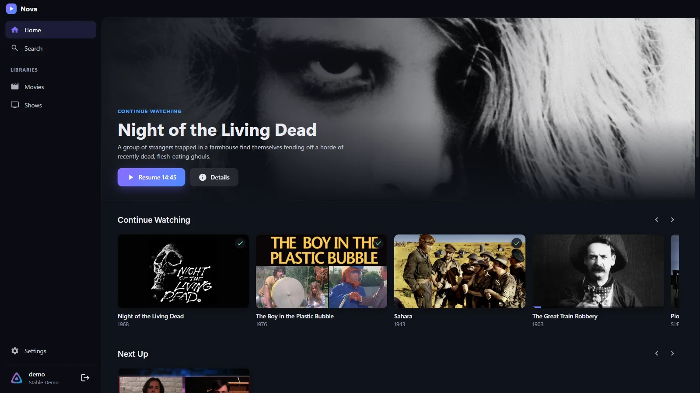
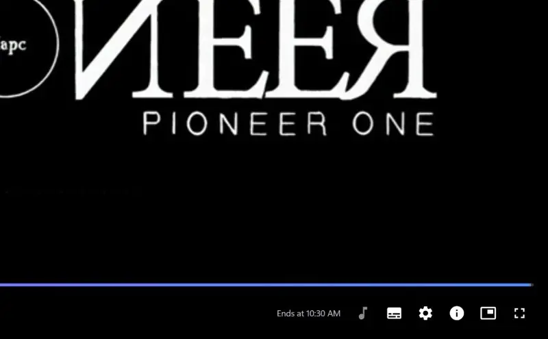
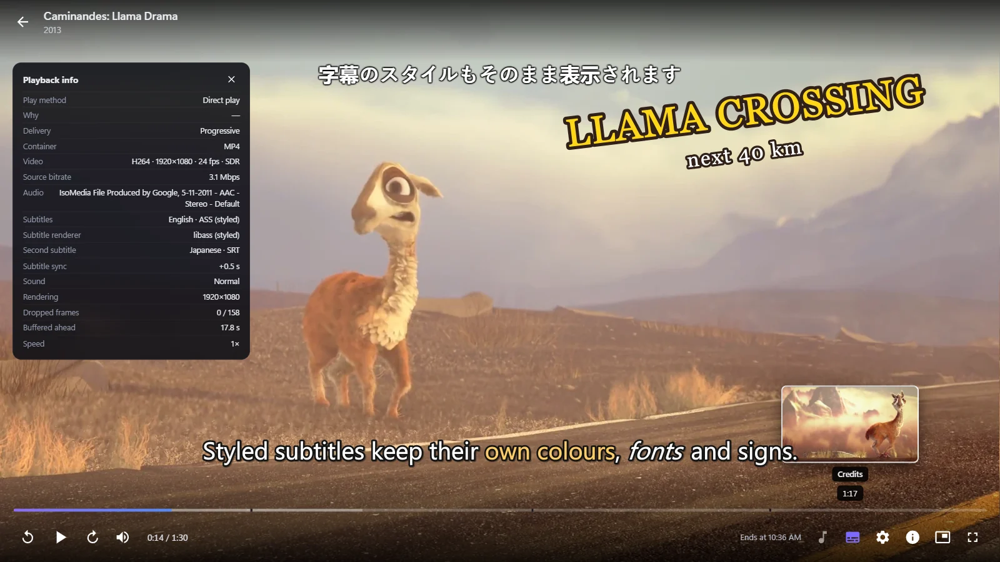
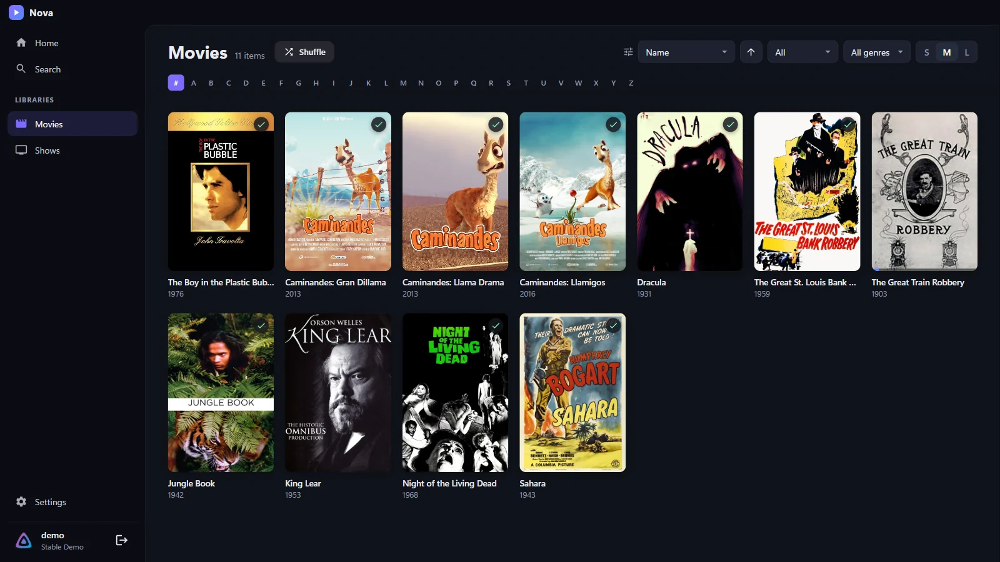
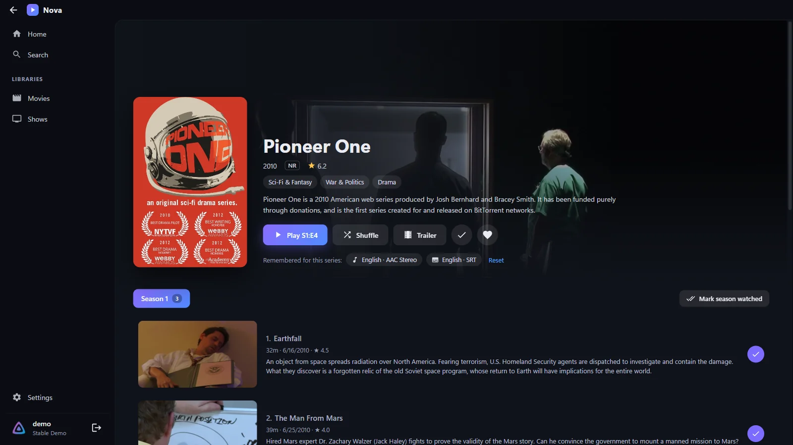
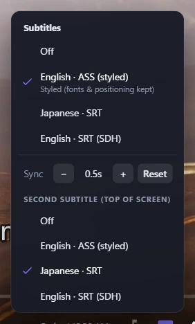
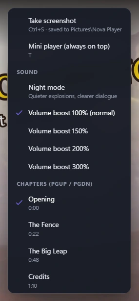
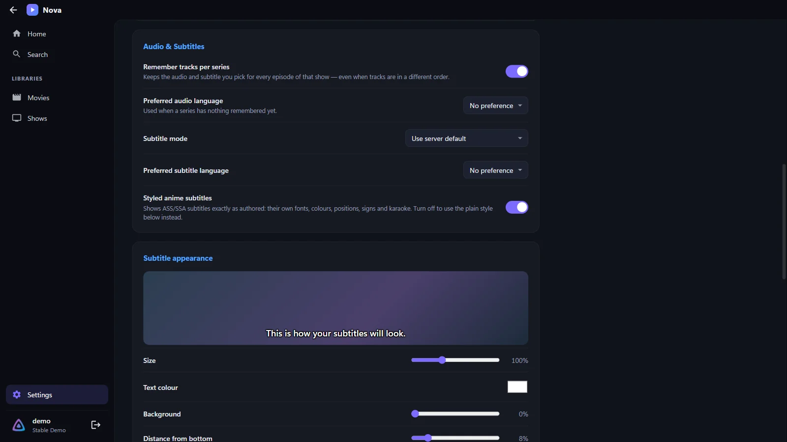

<div align="center">


# Nova Player

**The Jellyfin player for Windows that just works.**

Nova opens the moment you press Play, never freezes, remembers how you sort every library,
and keeps your audio and subtitle choices for the whole series.

[](https://github.com/Bryson-he/nova-player/releases/latest)
[](https://github.com/Bryson-he/nova-player/releases)


[](LICENSE)

### [⬇&nbsp; Download for Windows](https://github.com/Bryson-he/nova-player/releases/latest/download/NovaPlayer-Setup.exe)

<sub>[Portable version](https://github.com/Bryson-he/nova-player/releases/latest/download/NovaPlayer-Portable.exe) · [Website](https://bryson-he.github.io/nova-player/) · [All releases](https://github.com/Bryson-he/nova-player/releases)</sub>



</div>

## How it works

Sign in to your Jellyfin server once, and Nova feels like a streaming app: your libraries on the left, Continue
Watching and Next Up on the home screen, and a player that responds straight away.

<table>
<tr>
<td width="50%" align="center">
<br>
<b>Press Play, it plays</b><br>
<sub>The player opens instantly and you can always back out. No frozen window, ever.</sub>
</td>
<td width="50%" align="center">
<br>
<b>Up Next, automatically</b><br>
<sub>When the credits start, the next episode counts down and plays, with your tracks.</sub>
</td>
</tr>
</table>

Nova plays files directly whenever your PC can, and only asks your server to convert what it has to.

## Features

### 🚀 Never freezes on Play

The official Jellyfin desktop app can lock up the moment you start something. Nova can't:

- The player opens **instantly**. Everything after that happens in the background, with a **Cancel** button the
  whole time.
- Every request to your server has a timeout, and **Back** or **Esc** cancels it on the spot.
- If a file can't play directly on your PC, Nova **switches to server transcoding by itself** instead of hanging.
- If the server is slow, you get a clear message with **Retry**, **Retry with transcoding** and **Close**.
- Press **`I`** for the playback info panel. It tells you *why* something is transcoding, in plain English.

<div align="center">

</div>

### 🗂️ Sorting that sticks

Every library remembers its own **sort, order, filter, genre and card size**, even after a restart. Sort your anime
by *Latest episode added* once and it stays that way.

- Going back from a show restores your **exact scroll position**.
- **A–Z jump bar** when sorting by name, for big libraries.
- Filters for **Unwatched, Watched, In progress and Favorites**, plus genres.
- **Shuffle** a whole library, or a single show.

<div align="center">

</div>

### 🎧 Remembers your audio and subtitles for the whole series

Pick Japanese audio and English subtitles in any episode, and **every episode of that show follows**. Nova
remembers *what* the track is, not its position:

- language
- title (*Signs & Songs*, *Full Subtitles*…)
- forced or SDH
- commentary or main audio
- codec

So it picks the right tracks even when episodes order them differently, which is exactly where Jellyfin's own
"remember my selection" breaks. Subtitle sync is remembered per series too. You can see what's remembered on the
series page and reset it with one click.

<div align="center">

</div>

### 🌸 Anime subtitles done right

- **Styled ASS/SSA subtitles** are drawn by libass exactly as the release authored them: their own fonts
  (including ones embedded in the file), colours, signs, positioning and karaoke.
- **Dual subtitles**: show a second language at the top of the screen, for example English at the bottom and
  Japanese at the top. Great for learning a language.
- **Live sync** with `Z` / `X`, remembered for the series.
- Image subtitles (PGS / VobSub) are burned in by the server automatically.
- Plain subtitles get your own **size, colour, background, position and outline**.

<div align="center">

</div>

<table>
<tr>
<td width="50%" align="center" valign="top">
<br>
<sub>Subtitles menu: sync, and a second subtitle line</sub>
</td>
<td width="50%" align="center" valign="top">
<br>
<sub>Player menu: night mode, volume boost and chapters</sub>
</td>
</tr>
</table>

### 🎬 Built for binge-watching

- **Skip Intro / Recap** button, or skip automatically. Uses Jellyfin media segments (10.10+) or the Intro Skipper
  plugin.
- **Up Next** countdown when the credits start, then the next episode plays.
- **Chapters**: marks on the seek bar, chapter names on hover, a chapter list, and `PgUp` / `PgDn` to jump.
- **Trickplay previews** when you hover the seek bar.
- **Night mode** evens out explosions and dialogue, and **volume boost** goes up to 300% for quiet files.
- Remove things from **Continue Watching**, and **mark a whole season watched** in one click.

### 🪟 Mini player

Press **`T`** and Nova shrinks into a small always-on-top window in the corner of your screen, subtitles and all.
Keep watching while you work. Press `T` again to go back.

<div align="center">

</div>

### ✨ And the rest

- **Updates itself:** new versions download in the background and install when you close Nova, or click
  **Restart to update**.
- **Screenshots:** `Ctrl+S` saves the full-resolution frame to `Pictures\Nova Player`.
- **Quality menu** for watching away from home, and playback speed from 0.5× to 2×.
- **Streaming buffer** setting (1, 3 or 10 minutes ahead) for slow or unstable connections.
- **"Ends at"** time on every movie and episode.
- **Trailers, cast and "More like this"** on every details page.
- **Search** across movies, shows and episodes.
- **Quick Connect** sign-in. Your login is encrypted with Windows' own data protection.
- **Media keys** work, and your screen won't go to sleep while something is playing.
- Remembers **volume, window size and position**.

<details>
<summary><b>📸 See more screenshots</b></summary>
<br>

| | |
|---|---|
|  |  |
| **Settings:** track memory, languages and subtitle style | **Player:** playback info, chapters and previews |
|  |  |
| **Library:** sorting that sticks | **Home:** Continue Watching, Next Up, Favorites |

</details>

## Install

1. Download **[`NovaPlayer-Setup.exe`](https://github.com/Bryson-he/nova-player/releases/latest/download/NovaPlayer-Setup.exe)**
   from the latest release.
2. Run it. By default it installs just for you, so it doesn't need admin rights.
3. Windows may show **"Windows protected your PC"** because the installer isn't code-signed yet. Click
   **More info → Run anyway**.

Prefer not to install anything? The **[portable version](https://github.com/Bryson-he/nova-player/releases/latest/download/NovaPlayer-Portable.exe)**
runs from anywhere. It can't update itself, but it tells you when there's a new version.

Works with **Jellyfin 10.8 and newer** on **Windows 10 and 11** (64-bit).

## Getting started

1. **Connect.** Type your server address, like `192.168.1.20:8096` or `https://jellyfin.example.com`. Nova tries
   `http`, `https` and port 8096 for you.
2. **Sign in** with your username and password, or use **Quick Connect** from a device that's already signed in.
3. **Set your sort.** Open a library and pick how you like it sorted. Nova remembers it from now on.
4. **Pick your tracks once.** Start an episode, choose audio and subtitles, and the rest of the series follows.

> [!TIP]
> Want **Skip Intro**? On Jellyfin 10.10 or newer, turn on media segment detection in your server's dashboard, or
> install the **Intro Skipper** plugin. Nova picks the segments up automatically.

## Keyboard shortcuts

| Key | Action | Key | Action |
|---|---|---|---|
| `Space` / `K` | Play / pause | `F` / double-click | Fullscreen |
| `←` / `→` | Seek (hold `Shift` for 60 s) | `M` | Mute |
| `J` / `L` | −10 s / +10 s | `A` / `S` | Cycle audio / subtitles |
| `↑` / `↓` | Volume | `Z` / `X` | Subtitle sync −/+ 0.1 s |
| `0`–`9` | Jump to 0–90 % | `[` / `]` | Slower / faster |
| `N` / `P` | Next / previous | `I` | Playback info |
| `PgUp` / `PgDn` | Previous / next chapter | `T` | Mini player |
| `Ctrl+S` | Screenshot | `Enter` | Press "Skip" |
| `Esc` | Exit fullscreen or mini player, then close | | |

## FAQ

<details>
<summary><b>A video won't play, or it's transcoding when I don't expect it to.</b></summary>

Press **`I`** while it's playing. The **Why** line says what your PC can't handle, like 10-bit H.264 or DTS audio.
Nova then asks the server to convert just that part. If playback fails completely, choose **Retry with transcoding**.
</details>

<details>
<summary><b>Subtitles say "Could not load subtitles".</b></summary>

Update Nova first (Settings → Updates → **Check now**). Jellyfin 10.11 and newer changed how media links are
signed, and Nova 1.2.1+ handles both the old and new way. If it still happens, try another subtitle track and check
your server's log for that file.
</details>

<details>
<summary><b>The Skip Intro button never shows up.</b></summary>

Nova uses the intro and credit markers your server provides. On Jellyfin 10.10+, enable media segments in the
dashboard and let the scheduled task scan your library, or install the **Intro Skipper** plugin.
</details>

<details>
<summary><b>Styled subtitles look wrong, or use the wrong font.</b></summary>

Fonts come from the video file itself when it includes them. If a font is missing, libass falls back to a similar
one. You can switch to plain subtitles under **Settings → Audio & Subtitles → Styled anime subtitles**.
</details>

<details>
<summary><b>Windows blocked the installer.</b></summary>

Nova isn't code-signed yet, so SmartScreen may warn you: click **More info → Run anyway**. If **Smart App Control**
is turned on, Windows may block unsigned apps entirely; there's no safe way around that until Nova is signed.
</details>

<details>
<summary><b>Does Nova change anything on my server?</b></summary>

It only does what any Jellyfin app does: it reports what you watch, so your progress and Continue Watching stay in
sync across devices. Your audio and subtitle memory, library sorting and settings are stored on your PC.
</details>

<details>
<summary><b>Where are my settings?</b></summary>

In `%APPDATA%\Nova Player\nova-store.json`. Screenshots go to `Pictures\Nova Player`.
</details>

## How it plays your videos

When you press Play, Nova tells your server exactly which formats this PC can decode (H.264, HEVC, AV1, VP9, AAC,
Opus, FLAC… checked live on your hardware). If the file fits, it **direct plays** with no conversion at all. If only
the container doesn't fit, the server **remuxes** it without touching quality. Only what's truly unsupported gets
**transcoded**, streamed over HLS.

Styled subtitles are rendered by **libass** compiled to WebAssembly (JASSUB), on a separate thread, so even heavy
karaoke and typesetting don't slow the player down.

## For developers

<details>
<summary><b>Run from source, build and release</b></summary>
<br>

You'll need Node.js 20 or newer.

```
git clone https://github.com/Bryson-he/nova-player.git
cd nova-player
npm install
npm start
```

`npm run dist` builds the installer and portable `.exe` into `dist/`.

**Releasing:** bump `version` in `package.json`, commit, then tag and push:

```
git tag v1.2.1
git push origin main --tags
```

GitHub Actions builds both executables, uploads them to a draft release, checks everything is there, and publishes
it. Installed copies pick the update up automatically.

| Path | What it is |
|---|---|
| `src/main/main.js` | Window, settings storage, mini player, screenshots, auto-update |
| `src/renderer/js/player.js` | The player: direct play / HLS, tracks, subtitles, skip intro, up next, sound |
| `src/renderer/js/tracks.js` | Audio and subtitle choice, and per-series memory |
| `src/renderer/js/subtitles.js` | Plain subtitle parser and renderer (styling, sync) |
| `src/renderer/js/profile.js` | Detects what this PC can decode and builds the Jellyfin device profile |
| `src/renderer/js/api.js` | Jellyfin API client with timeouts and cancellation |
| `src/renderer/js/views/` | Home, library, details, search, settings and sign-in |
| `scripts/copy-vendor.js` | Bundles hls.js and JASSUB into the app |
| `docs/` | The website (GitHub Pages) and README images |
| `.github/workflows/release.yml` | Builds and publishes releases |

</details>

## Credits

Built with [Electron](https://www.electronjs.org/), [hls.js](https://github.com/video-dev/hls.js) (Apache 2.0) and
[JASSUB](https://github.com/ThaUnknown/jassub) / [libass](https://github.com/libass/libass) (MIT / ISC). Demo
screenshots use [Caminandes](https://www.caminandes.com/) (CC BY 3.0, Blender Foundation) and
[Pioneer One](https://en.wikipedia.org/wiki/Pioneer_One) (CC BY-NC-SA) from the Jellyfin demo server.

Nova Player is an independent project and isn't made by or affiliated with the Jellyfin project.

Released under the [MIT License](LICENSE).
