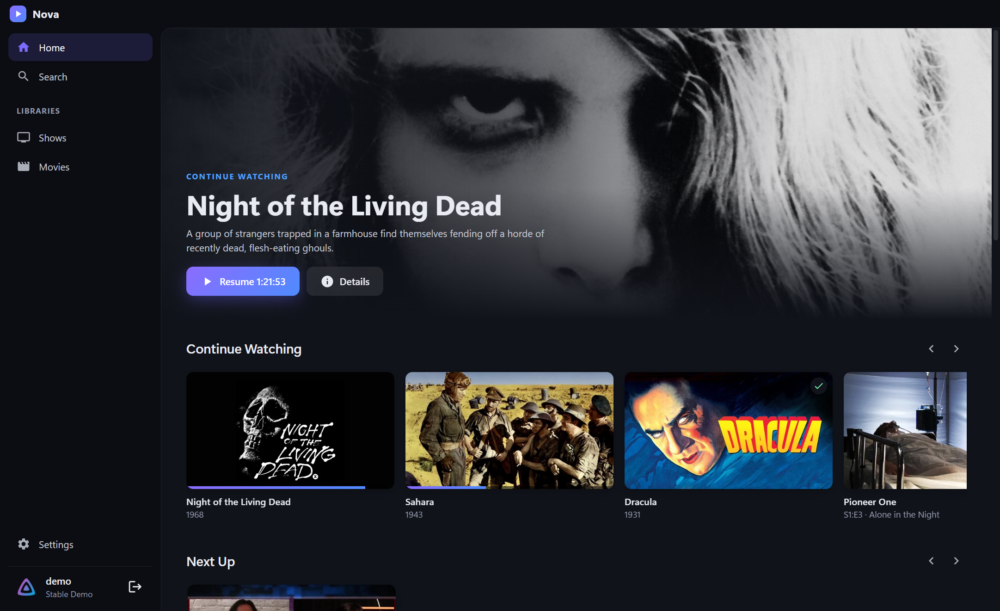
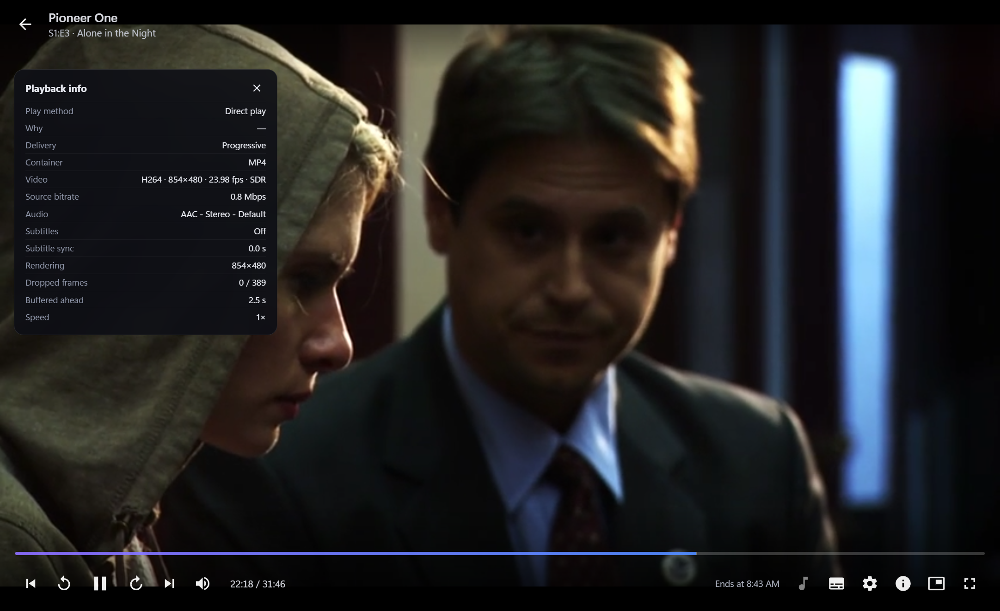
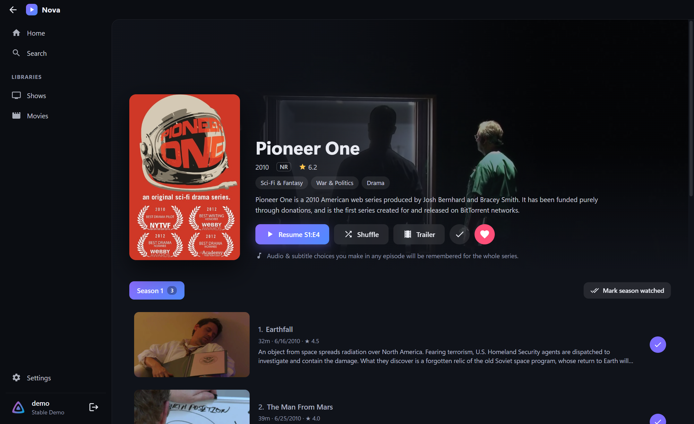
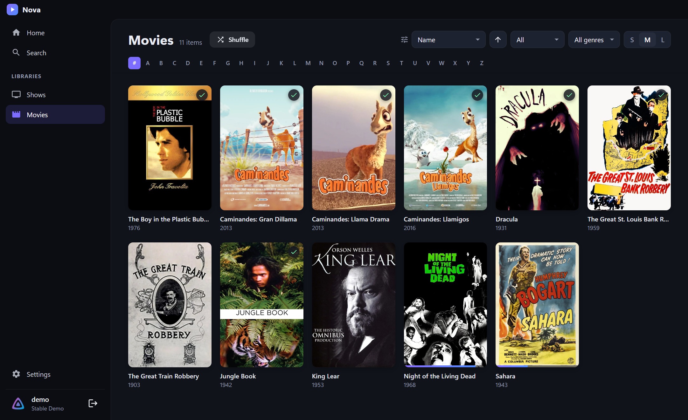

<div align="center">


# Nova Player

**A fast, modern Jellyfin player for Windows. It doesn't freeze, and it remembers what you chose.**

[](https://github.com/Bryson-he/nova-player/releases/latest)
[](https://github.com/Bryson-he/nova-player/actions/workflows/release.yml)
[](LICENSE)

[**Download for Windows**](https://github.com/Bryson-he/nova-player/releases/latest/download/NovaPlayer-Setup.exe) · [Portable .exe](https://github.com/Bryson-he/nova-player/releases/latest/download/NovaPlayer-Portable.exe) · [Website](https://Bryson-he.github.io/nova-player/)



</div>

---

## Why Nova?

Nova fixes three common complaints about the official Jellyfin desktop player.

### 🚀 No more freezing when you press Play
- The player opens instantly.
- Every server request runs in the background, with a timeout, and is cancelled the moment you press **Back** or **Esc**.
- Video decoding runs in Chromium's hardware-accelerated media pipeline, and streams are prepared off the UI thread.
- If your PC can't play a file directly, Nova switches to server transcoding on its own instead of hanging.
- If the server is slow, you see a clear message with **Retry**, **Retry with transcoding** and **Close** buttons.

### 🗂️ Library sorting that sticks
- Every library remembers its own sort field, order, filter (unwatched, watched, in progress, favorites), genre and card size, even after a restart.
- Going back from a movie or show restores your exact scroll position.
- Sorting by name adds an **A–Z jump bar**.

### 🎧 Audio & subtitles remembered for the whole series
Change the audio or subtitles in any episode and every later episode of that show follows. Nova remembers **what the track is**, not its position:

- language
- title ("Signs & Songs", "Full Subtitles"…)
- forced / SDH
- commentary vs. main audio
- codec

So the right tracks are picked even when episodes have their tracks in a different order. That's the classic case where Jellyfin's own "remember selection" breaks. You can see or reset the remembered tracks on the series page, or under **Settings → Remembered series**.

## Screenshots

| Player | Series |
|---|---|
|  |  |
| **Library** | **Home** |
|  |  |

## Features

**Playback**
- Direct play whenever your PC supports the file: H.264, HEVC*, AV1, VP9, AAC, Opus, FLAC, MP4/MKV/WebM. Anything else is transcoded by the server.
- Skip Intro / Recap button, or auto-skip. Needs Jellyfin 10.10 media segments or the Intro Skipper plugin.
- **Up Next** card with a countdown when the credits start, and auto-play of the next episode.
- Trickplay thumbnails when hovering the seek bar.
- Quality menu (great for watching away from home) and playback speed.
- **Chapters**: marks on the seek bar, chapter names on hover, a chapter list, and `PgUp` / `PgDn` to jump.
- **Night mode** (quieter explosions, clearer dialogue) and **volume boost** up to 300%.
- **Screenshots** with `Ctrl+S`, saved at full resolution to `PicturesNova Player`.
- **Streaming buffer** setting (1, 3 or 10 minutes ahead) for slow or unstable connections.
- Playback info panel (`I`) that shows *why* something is transcoding.
- **Mini player**: press `T` for a small always-on-top window in the corner of your screen.
- Media keys, and your screen won't go to sleep during playback.

\* HEVC needs hardware decoding support on your GPU.

**Subtitles**
- **Styled anime subtitles (ASS/SSA)**, rendered by libass exactly as authored: the release's own embedded fonts, colours, signs, positioning and karaoke.
- **Dual subtitles**: show a second language at the top of the screen, for example English at the bottom and Japanese at the top.
- Size, colour, background, position and outline for plain subtitles, with a live preview in Settings.
- Live sync adjustment with `Z` / `X`, **remembered per series** (or per movie).
- Image subtitles (PGS / VobSub) are burned in by the server automatically.
- Smart mode: shows subtitles only when the audio isn't in your language.

**Library**
- Continue Watching (with an ✕ to remove things), Next Up, Favorites and Recently Added.
- **Shuffle** a show or a whole library.
- Mark a whole season watched in one click.
- Trailers, cast and "More like this".
- Search across movies, shows and episodes.

**App**
- Automatic updates from GitHub Releases.
- Quick Connect sign-in. Your login token is encrypted with Windows DPAPI.
- Remembers volume, window size and position.
- Handles expired sessions cleanly by sending you back to sign-in.

## Keyboard shortcuts

| Key | Action | Key | Action |
|---|---|---|---|
| `Space` / `K` | Play / pause | `F` / double-click | Fullscreen |
| `←` / `→` | Seek (hold `Shift` for 60 s) | `M` | Mute |
| `J` / `L` | −10 s / +10 s | `A` / `S` | Cycle audio / subtitles |
| `↑` / `↓` | Volume | `Z` / `X` | Subtitle sync −/+ 0.1 s |
| `0`–`9` | Jump to 0–90 % | `[` / `]` | Slower / faster |
| `N` / `P` | Next / previous | `I` | Playback info |
| `PgUp` / `PgDn` | Previous / next chapter | `T` | Mini player (always on top) |
| `Ctrl+S` | Screenshot | `Enter` | Press "Skip" |
| `Esc` | Exit fullscreen / mini player, then close | | |

## Install

1. Download **[NovaPlayer-Setup.exe](https://github.com/Bryson-he/nova-player/releases/latest/download/NovaPlayer-Setup.exe)** and run it.
2. Windows may say *"Windows protected your PC"* because the app isn't code-signed. Click **More info → Run anyway**.
3. Enter your server address (for example `192.168.1.20:8096` or `https://jellyfin.example.com`) and sign in.

The installed version updates itself. The **portable** .exe can't self-update, so it shows you when a new version is out.

Works with Jellyfin **10.8 and newer** on Windows 10 / 11 (x64).

## Building from source

```bash
git clone https://github.com/Bryson-he/nova-player.git
cd nova-player
npm install
npm start          # run the app
npm run dist       # build the installer + portable exe into dist/
```

Settings live in `%APPDATA%\Nova Player\nova-store.json`.

### Releasing a new version

1. Bump `version` in `package.json` (for example `1.2.0`).
2. Commit, then tag and push:
   ```bash
   git tag v1.2.0 && git push origin main --tags
   ```
3. GitHub Actions builds the installer and publishes the release. Everyone's installed copy picks it up automatically.

## Project layout

```
src/main/        Electron main process: window, settings storage, auto-update
src/renderer/    The app UI (plain ES modules, no framework or build step)
  js/player.js   Player: loading, direct play / HLS, tracks, skip intro, up next
  js/tracks.js   Audio/subtitle selection and per-series memory
  js/views/      Home, library, details, search, settings, login
docs/            Website (GitHub Pages)
```

---

<sub>Nova Player is an independent project and isn't affiliated with the Jellyfin project. MIT licensed.</sub>
